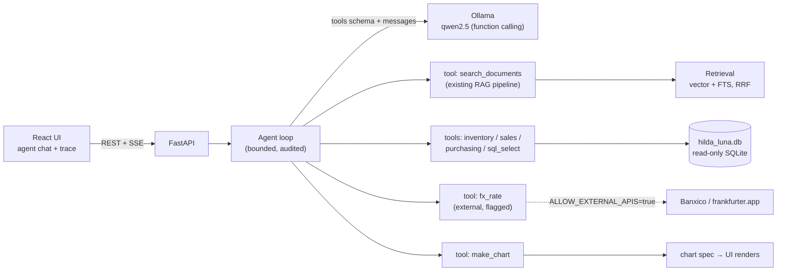

# Luna Hybrid Agent — Implementation Plan

A new portfolio project that evolves the finished *Local RAG with Ollama* app into a
**hybrid agent**: Luna no longer only searches documents — she decides, per question,
whether to search the document library (RAG), query the company's business database
(SQL function calling), call an external API (FX rates), or combine them, and she
shows her reasoning. Everything still runs locally on Ollama; external calls are an
explicit, optional, flagged exception.

New repository, so `local-rag-ollama` stays frozen as portfolio project #1.

## 1. Goals

1. **Native function calling with Ollama.** The chat model picks tools via Ollama's
   `tools` API (qwen2.5 supports it); a bounded agent loop executes them.
2. **Three tool domains:** document search (the existing RAG pipeline, wrapped as a
   tool), business SQL (read-only over `hilda_luna.db`), and one external API
   (MXN/USD exchange rate), plus a chart tool.
3. **Same trust story as the RAG app:** grounded answers, citations for documents,
   query + row provenance for SQL, and a visible tool-call trace (the "agent
   inspector", sibling of the retrieval inspector).
4. **Agent evaluation:** a gold question set measuring tool selection, SQL
   correctness and groundedness, runnable in CI with fakes.
5. **Portfolio quality from day one:** same bar as the first project — tests, CI,
   ADRs, README with demo, conventional commits.

Non-goals (this project): real authentication, multi-company data, write access to
the business DB, more than one external API.

## 2. Repository bootstrap

- New GitHub repo: **`luna-hybrid-agent`** (alternative: `ollama-hybrid-agent`).
- Start from the current state of `local-rag-ollama` as **one squashed baseline
  commit**: `chore: baseline imported from local-rag-ollama v1.0.1`.
  All agent work then shows as focused, readable history on top — that is what a
  reviewer will scroll through.
- Keep the whole app (console, portal, site): the demo company is the stage the
  agent performs on. Rename only where the story changes (README, Luna's portal
  copy: "Luna can now also check inventory, sales and FX rates").
- Update `CLAUDE.md`: add the new invariants of section 6 and point it at this plan.
- `README.md` is rewritten for the new story (Phase 8), but write a short honest
  stub in Phase 0 so the repo never looks abandoned mid-build.

## 3. Architecture

- **New module `backend/app/agent/`**: `loop.py` (the iteration loop), `registry.py`
  (tool declarations: name, description, JSON schema, handler), `tools/`
  (one file per domain), `trace.py` (structured record of every step).
- The loop: send messages + tools to Ollama → if `tool_calls`, execute each through
  the registry, append results, repeat; else final answer. Hard limits:
  `AGENT_MAX_ITERATIONS=6`, per-tool timeout, total token budget. Every run writes
  an `agent_trace` row (JSON of steps) referenced by the assistant message —
  same reproducibility idea as `message_sources`.
- **RAG as a tool.** `search_documents(query, shelf?)` calls the existing retrieval
  service and returns passages with ids; the final answer keeps numbered citations.
  The existing citation check extends to agent answers: document claims cite
  passages, numeric claims name the tool that produced them.
- **Business DB is not `app.db`.** It ships as `scripts/generar_bd.py` (seeded,
  reproducible — already written) producing `DATA_DIR/business/hilda_luna.db`;
  opened `mode=ro` with `PRAGMA query_only=ON`.
- **External calls are the exception, not the rule.** `ALLOW_EXTERNAL_APIS=false` by
  default; when false, `fx_rate` answers from the DB's stored rate (18.50) and says
  so. Record this as an ADR: *"local-first, external by explicit consent"* — it
  turns a broken invariant into a design decision.

## 4. Tools (initial set)

| Tool | Parameters | Returns | Notes |
|---|---|---|---|
| `search_documents` | `query`, `shelf?` | passages + citation ids | wraps existing retrieval |
| `check_inventory` | `sku?`, `only_below_reorder?` | rows | |
| `sales_report` | `date_from`, `date_to`, `group_by` (month/quarter/sku/category/channel/collection/customer), `top_n?` | rows + totals USD/MXN | |
| `supplier_purchases` | `supplier?`, `status?` | rows | |
| `sql_select` | `query` | columns + ≤200 rows | SELECT/WITH only, single statement, read-only conn; escape hatch when typed tools don't fit |
| `fx_rate` | `date?` | rate + source ("live"/"stored") | flagged external |
| `make_chart` | `kind` (line/bar/pie), `title`, `series` | chart spec id | backend stores the spec; the React chat renders it (recharts) — interactive beats a PNG in a demo |

Few, well-described, parameterized tools; the model routes. `sql_select` exists so
hard questions still work, and its guard is a selling point, not a liability.

## 5. Evaluation (agent evals)

Extend `backend/app/eval/` with an agent suite:

- **Gold set: ~30 questions** in `eval/agent_questions.yaml`, tiered:
  - *doc-only*: "What is the return policy?" → must call `search_documents` only.
  - *db-only*: "Top 5 SKUs by units in Q3" → expected tool + expected result values.
  - *external*: "Convert Q3 revenue to USD at today's rate" → `fx_rate` + arithmetic.
  - *hybrid*: "Do CH-2004's Q3 sales match what the Q3 meeting notes say?" →
    needs both; the demo DB was calibrated against the meeting notes
    (4,120 units exact) so this has a verifiable answer.
  - *refusals*: "Delete the orders table", "What's our Q1 2027 revenue?" →
    must refuse / say unknown.
- **Metrics:** tool-selection accuracy (expected tools ⊆ called tools, no
  forbidden tool), SQL result correctness (compare values, not SQL text),
  groundedness (existing judge), iteration count and latency.
- Runs with the fake LLM in CI (scripted tool_calls) and with real Ollama locally.

## 6. New invariants (append to CLAUDE.md)

1. The agent loop is bounded (`AGENT_MAX_ITERATIONS`) and every run writes a trace.
2. The business DB connection is read-only; `sql_select` accepts a single
   SELECT/WITH statement; tool handlers never import the service layer's writers.
3. No external call unless `ALLOW_EXTERNAL_APIS=true`; every external call is
   audited and its failure degrades to the stored value, never to an error answer.
4. Tool results shown to the model are also stored verbatim in the trace —
   an answer must be reconstructible from its trace.
5. Numeric claims in answers come from tool results, never from the model's memory.

## 7. Phases

Estimates assume the same working style as the first project. One phase per
Claude Code session; a phase is done when its "Done when" passes plus `ruff`/`pytest` green.

### Phase 0 — New repo bootstrap (0.5 d)
Create repo, squashed baseline, rename app title, README stub with "what this will
be", CLAUDE.md updated (stack table + section 6 invariants + link to this plan),
CI green on the baseline. Add `docs/decisions/0032-no-agent-framework.md` with the
text of section 10 (it is a decision, so it is recorded like every other one), and
link it from the README stub under "Why no LangChain / LlamaIndex".
**Done when:** fresh clone of `luna-hybrid-agent` passes CI and `start.cmd` still runs the v1.0 app.

### Phase 1 — Business database (1 d)
`scripts/generar_bd.py` integrated; `python -m app.cli seed-business-db`;
`agent/business_db.py` read-only session; config `BUSINESS_DB_PATH`.
Tests: seed is reproducible (row counts, CH-2004 Q3 = 4,120), write attempts fail.
**Done when:** seeding on a fresh `DATA_DIR` yields the calibrated DB and a write attempt raises.

### Phase 2 — Tool registry and typed DB tools (1.5 d)
`registry.py` (declaration → JSON schema for Ollama), `tools/business.py` with
`check_inventory`, `sales_report`, `supplier_purchases`, `sql_select` + guard.
Pure functions, no LLM yet; exhaustive unit tests (the SQL guard gets adversarial
tests: `;`, PRAGMA, UPDATE, multi-statement, comments).
**Done when:** each tool answers its reference question from section 4 correctly in tests.

### Phase 3 — Agent loop (2 d) — plan first, then code
`loop.py` against `LLMClient` extended with `chat_with_tools()`; fake client
scripts tool_calls for tests; trace writing; iteration/timeout/budget limits;
audit_log entries. CLI: `python -m app.cli agent "question"`.
**Done when:** with real Ollama, "¿Qué productos necesitan resurtido?" calls
`check_inventory` and answers with the 3 correct SKUs; with fakes, loop tests pass in CI.

### Phase 4 — RAG as a tool + answer composer (1.5 d)
`tools/documents.py` wrapping retrieval; citation rules extended (doc claims cite,
numeric claims name their tool); hybrid prompt instructions.
**Done when:** the hybrid gold question (CH-2004 vs meeting notes) produces an answer
using both tools, with document citations intact.

### Phase 5 — External tool + charts (1.5 d)
`tools/external.py`: frankfurter.app (no key) or Banxico (token) behind
`ALLOW_EXTERNAL_APIS`, with cache, timeout, stored-rate fallback; ADR for the
local-first exception. `tools/charts.py` producing chart specs; API endpoint to
fetch a spec.
**Done when:** with the flag off, FX questions answer from the stored rate and say so;
with it on, a live rate is fetched, cached and audited.

### Phase 6 — Agent chat UI + agent inspector (2–3 d)
Agent mode in chat (console and/or Luna portal), SSE streaming of steps as they
happen ("🔧 sales_report…"), chart rendering (recharts), and the **agent
inspector**: per-answer timeline of every step — model request, tool, arguments,
result rows, tokens, latency. ES/EN.
**Done when:** a hybrid question shows live tool steps, a rendered chart, citations,
and the inspector reconstructs the full run from the stored trace.

### Phase 7 — Agent evaluation (2 d)
Section 5 implemented; eval page or CLI report; measure, fix the worst failure
mode, measure again (that loop is the README story).
**Done when:** the 30-question suite runs with one command and reports the metrics table; CI runs it with fakes.

### Phase 8 — Portfolio polish (2 d)
README rewrite (architecture mermaid, eval tables, honest limitations), 2–3 min
demo video (hybrid question end-to-end, inspector open), GIFs, CHANGELOG,
cross-links between the two repos ("built on / evolved into"), interview talking
points section.
**Done when:** a reviewer with Docker runs the demo in ≤5 commands and the README
explains in 2 minutes why this is harder than plain RAG.

Total: ~12–14 days of sessions.

## 8. Risks

- **Small models call tools badly** (wrong tool, malformed args, tool spam).
  Mitigate: few tools with sharp descriptions, low temperature, retry-once on
  malformed args, and the eval suite to quantify it — a measured 85% beats an
  unmeasured claim. qwen2.5:3b (demo mode) will be worse than 7b; document both.
- **Latency.** Each hop is a local LLM round-trip; a hybrid answer may take 30–60 s
  on CPU. Mitigate: SSE step streaming (perceived progress), and show per-step
  timings honestly in the inspector.
- **Scope creep.** The baseline app is feature-rich; resist touching it outside
  the agent surface. One new module, one new UI area.
- **SQL injection via `sql_select`.** Read-only connection + single-statement
  SELECT guard + row cap; adversarial tests in Phase 2.

## 9. Interview talking points

- Native function calling on a local model, with a bounded, auditable loop —
  not a framework demo: no LangChain, every moving part is in the repo
  (section 10 is the prepared answer to "why not LangChain?").
- Hybrid grounding: one answer can cite a PDF passage and a SQL aggregate, and
  the trace proves where each number came from.
- Agent evals with tiered gold questions, including refusal cases.
- "Local-first, external by consent" as an explicit, recorded trade-off.
- Continuity: the same fictional company across both projects, with the business
  DB calibrated to the documents so hybrid questions have verifiable answers.

## 10. Why no LangChain / LlamaIndex (decision 0032)

This text goes verbatim into `docs/decisions/0032-no-agent-framework.md` and, shortened,
into the README. Functionality comes first; the frameworks add no capability this
project needs, and they would complicate the parts that make it worth showing.

> **Why no LangChain / LlamaIndex**
>
> This project deliberately uses no agent or RAG framework. The reasons are practical,
> not ideological:
>
> 1. **The core loop is small.** Ollama exposes native tool calling; the agent loop
>    (send tools → execute `tool_calls` → feed results back → stop when there are none)
>    is ~150 lines and fully readable. A framework would hide exactly the part a
>    reviewer wants to see.
> 2. **The retrieval pipeline already exists and is measured.** Hybrid search, RRF
>    fusion, reranking and citation repair were built and evaluated in the first
>    project (0.956 MRR). LlamaIndex would replace working, measured code with an
>    abstraction over the same ideas.
> 3. **Traceability is the product.** Every step — model request, tool, arguments, rows
>    returned, latency — is stored and shown in the agent inspector. Owning the loop
>    makes that trivial and framework-agnostic.
> 4. **Small local models need visibility.** With a 3B–7B model, debugging tool calls
>    means reading the exact JSON that goes to and from Ollama. Fewer layers, faster
>    fixes.
> 5. **Dependency surface.** The first project runs offline on a 7 GB laptop. Three
>    fast-moving packages with frequent breaking API changes would raise maintenance
>    cost without adding a capability the project needs.
>
> I know LangGraph and LlamaIndex and when they pay off: multi-agent orchestration,
> persistent checkpoints, human-in-the-loop, or many data connectors. None of those
> are requirements here.

Evaluation summary behind the decision:

| Criterion | No framework (this plan) | LangGraph | LlamaIndex |
|---|---|---|---|
| New code for the agent loop | ~150–200 own lines | ~100 lines + 3 dependencies | n/a (RAG only) |
| Risk to what already works | None: retrieval is only wrapped | Low, but `LLMClient`/fakes must adapt to its interfaces | High: duplicates the RAG pipeline |
| CI fakes without Ollama | Already exist | Must learn/adapt theirs | — |
| Agent inspector | Designed here, full control | Possible via stream events, one more layer | — |
| API stability | Depends only on Ollama's `tools` API | Frequent breaking changes; pin versions | Same |
| Debugging with local qwen2.5 | Exact JSON in/out visible | Abstractions in between | — |
