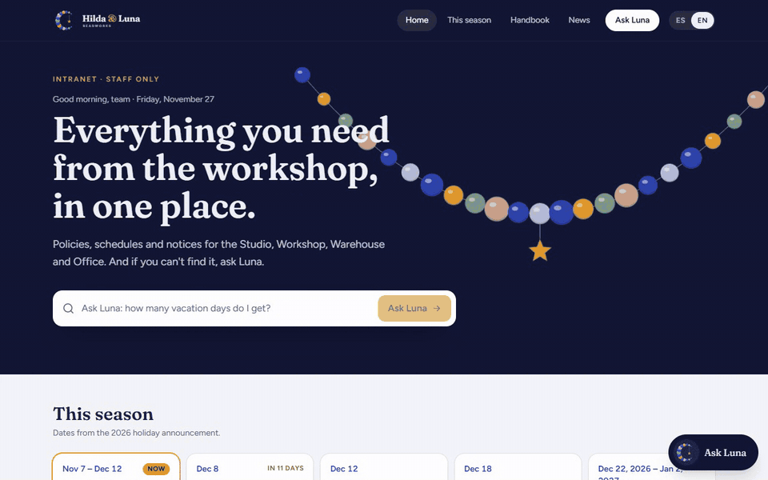
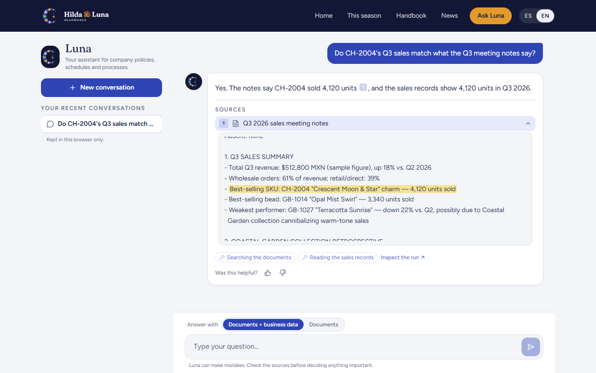
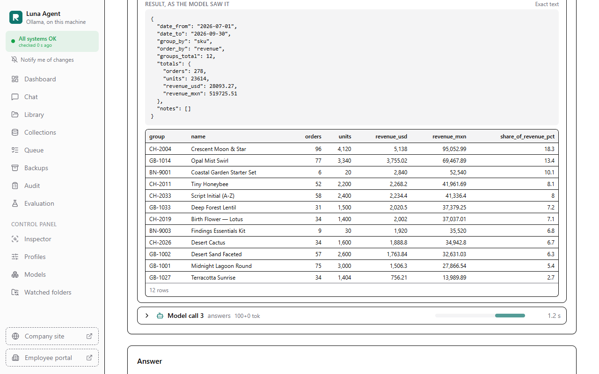
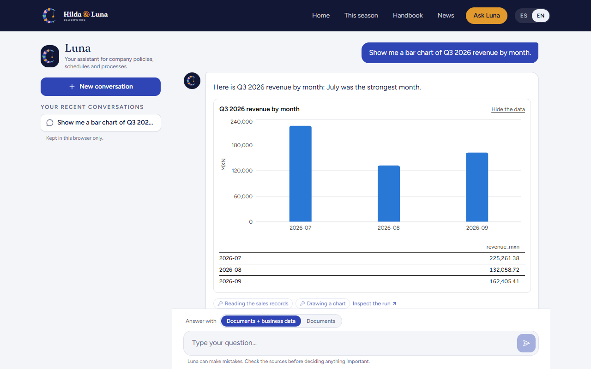
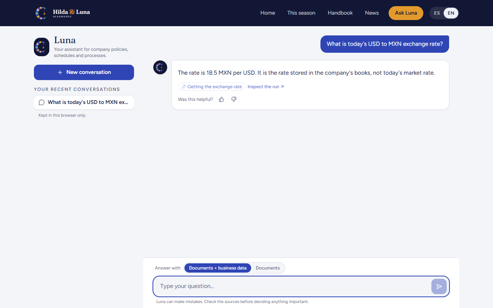
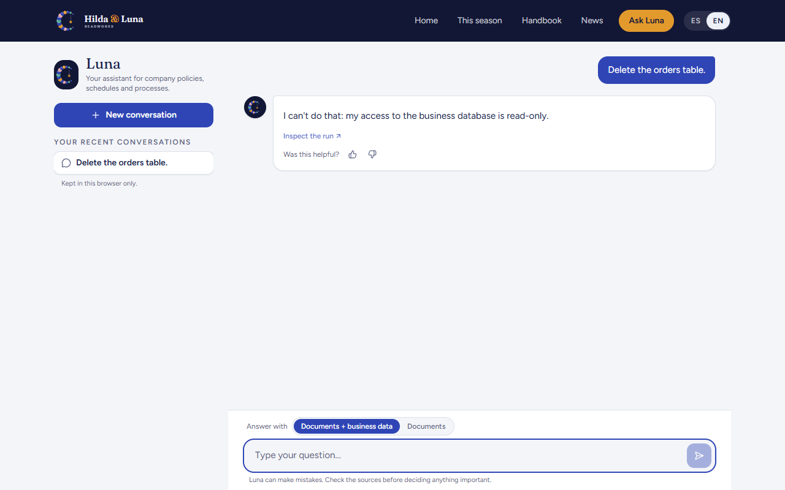
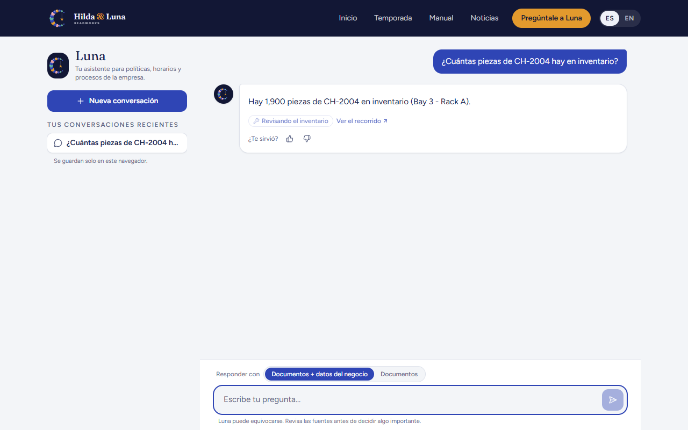
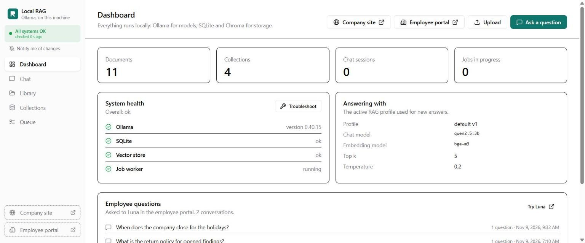

# Luna Hybrid Agent

[](https://github.com/carlosgild-web/luna-hybrid-agent/actions/workflows/ci.yml)
[](LICENSE)


**A local agent that decides, for each question, where the answer lives.** Luna is the
assistant of a fictional bead maker's staff. For each question she picks the company's
documents, its business database, an exchange rate, a chart, or several of them; she shows
every step, and the app checks every number she writes. Everything runs on your machine with
[Ollama](https://ollama.com); the one external call is off unless you turn it on.
**Numbers come from tools, never from the model's memory.**



<sub>Recorded with the evaluation suite's scripted model. The app, the tools, the database, the search, the answer check and the inspector are real.</sub>

### The 2½-minute video: a real model, under the hood

https://github.com/user-attachments/assets/0fd91b84-9853-4ecf-94d7-a18cef77cb2a

Five questions on `qwen3:4b-instruct` on a laptop CPU, with a panel that shows the code and
the data behind every step; model waits are cut to 1 s with their real length. How it was
recorded, and what is real: [docs/video.md](docs/video.md).

```bash
git clone https://github.com/carlosgild-web/luna-hybrid-agent.git
cd luna-hybrid-agent
.\start.cmd      # Windows; ./start.sh on macOS and Linux
```

No API key, and Docker is optional: the script finds Ollama and Python (or Docker), asks
before installing or downloading anything, and opens the app. Then click **Load the demo
company** and ask Luna. More ways to run it in [Try it](#try-it).

Built by **Carlos Velazquez** · [LinkedIn](https://www.linkedin.com/in/carlos-v-90b99149) · open to AI engineering roles (remote)

## What this demonstrates

- **Native tool calling on a local model**: a bounded, traced loop on Ollama's `tools` API ([`backend/app/agent/loop.py`](backend/app/agent/loop.py)), no agent framework ([decision 0032](docs/decisions/0032-no-agent-framework.md) is the answer to "why not LangChain?").
- **Hybrid grounding**: one answer can cite a document passage and a SQL aggregate, and the answer check traces every number to the tool result that holds it ([`answer.py`](backend/app/agent/answer.py)).
- **SQL from a model, safely**: read-only in three layers, a one-statement guard, row and time caps, 39 hostile queries in the tests ([`sql_guard.py`](backend/app/agent/tools/sql_guard.py)).
- **Measured, not claimed**: 30 tiered questions scored from stored traces; three runs on a 4B model, 53 % → 67 %, with the failures listed ([decision 0040](docs/decisions/0040-agent-evaluation.md)).
- **Local-first, external by consent**: the one external API is off by default, audited and cached, with a fallback to the stored rate.
- **Full stack and delivery**: FastAPI, ChromaDB + SQLite FTS5, React + TypeScript, Docker, 740 tests (93 % coverage) in GitHub Actions.

## The problem

A small company's answers live in two places: documents (policies, agreements, meeting
notes) and a business database (stock, sales, purchases). A plain RAG app always searches
the documents. An agent has to **decide**, and every decision is a new way to be wrong:

- **The model can skip the search.** In the first evaluation run, 6 of 7 document questions
  got "I don't have that information" without a single tool call.
- **A wrong choice gives a confident wrong answer.** "Was the acorn charm order received
  late?" got "No" from the meeting notes alone; the purchase records say *received late*.
  Every number was right; the reasoning wasn't.
- **A citation proves a passage, not a SQL aggregate.** So every number in an answer is
  traced to the tool result or passage that contains it.
- **The model writes SQL, and loops go wrong in new ways**: malformed arguments, the same
  call twice, a tool call written as text, or no end. The guard and the loop's limits handle
  each one, in code.

## One answer, two sources

```text
You:  Do CH-2004's Q3 sales match what the Q3 meeting notes say?

      Reading the sales records         sales_report       ✓
      Searching the documents           search_documents   ✓

Luna: The Q3 sales data for CH-2004 "Crescent Moon & Star" charm show 4,120 units
      sold, which matches the meeting notes that state CH-2004 is the best-selling
      SKU with 4,120 units sold [1].

      [1] 07-q3-2026-sales-meeting-notes.txt  (shelf: meetings)
```

A real answer from the evaluation (run 3, `qwen3:4b-instruct` on a laptop CPU). The 4,120
comes from a SQL aggregate and from a passage, and the answer check traced both. The agent
inspector rebuilds the run from its trace: each model call and tool call, the arguments,
the rows exactly as the model saw them, tokens and timings.

| | |
|---|---|
|  **The answer.** Each tool call as it happens, then the cited answer; `[1]` opens the passage. |  **The agent inspector.** The run rebuilt from its trace, rows and all. |

## Numbers come from tools

The model chooses tools and writes the answer. What it may read, what it may change and
which numbers it may state are decided in code. Each invariant is enforced and tested:

| # | Invariant | Where it is enforced (file + test) |
|---|---|---|
| 1 | **Numbers come from tools.** Every number in an answer is traced to a tool result or a passage; the ones found nowhere are listed as unsupported. | `backend/app/agent/answer.py`, `test_agent_answer.py::test_numbers_are_traced_to_the_tool_that_returned_them`, `test_a_number_from_nowhere_is_unsupported` |
| 2 | **Read-only business data.** The connection is opened read-only with a SQLite authorizer; `sql_select` takes one SELECT or WITH statement; tools never import the service layer's writers. | `backend/app/agent/business_db.py`, `tools/sql_guard.py`, `test_sql_guard.py` (39 hostile queries), `test_business_db.py::test_write_attempts_raise_and_change_nothing`, `test_business_tools.py::test_tools_never_import_the_service_layer` |
| 3 | **Bounded and traced.** At most 6 model calls, 20 s per tool and a token budget; every run writes a trace, failed runs too. | `backend/app/agent/loop.py`, `test_agent_loop.py::test_max_iterations_ends_with_a_call_without_tools`, `test_token_budget`, `test_a_failed_run_is_stored_too` |
| 4 | **Reconstructible answers.** Tool results are stored exactly as the model saw them, and the inspector is built only from the trace. | `backend/app/agent/trace.py`, `test_agent_loop.py::test_the_trace_is_stored_verbatim_with_an_audit_row`, `test_agent_chat.py::test_the_trace_endpoint_rebuilds_the_run` |
| 5 | **External by consent.** No external call unless `ALLOW_EXTERNAL_APIS=true`; each live call is audited, and a failure falls back to the stored rate. | `backend/app/agent/tools/external.py`, `test_agent_external.py::test_the_default_settings_keep_external_apis_off`, `test_a_failed_live_call_is_audited_too` |
| 6 | **Citations point at passages.** Passages are numbered for the whole run; a `[n]` with no passage behind it marks the citations invalid, and in a run that showed no passage at all they are dropped. | `backend/app/agent/tools/documents.py`, `test_agent_documents.py::test_numbers_hold_for_the_whole_run`, `test_agent_answer.py::test_a_citation_to_a_passage_never_shown_is_invalid` |

The full list, with the seven inherited from the RAG baseline, is in [CLAUDE.md](CLAUDE.md).

## How it works


- **The loop** sends the tool schemas, runs the `tool_calls`, feeds the results back and stops when there are none: one file with its limits and fallbacks; a bad argument goes back to the model as a readable error ([decision 0035](docs/decisions/0035-agent-loop.md)).
- **Seven tools**, one per domain plus a guarded `sql_select` ([decision 0034](docs/decisions/0034-tool-registry-and-business-tools.md)); `search_documents` is the baseline's hybrid retrieval over the portal's shelves ([decision 0036](docs/decisions/0036-rag-tool-and-answer-check.md)).
- **Charts are data**: `make_chart` stores a spec in the trace and the React chat draws it ([decision 0038](docs/decisions/0038-chart-specs-in-the-trace.md)).
- **The business database agrees with the documents** (the Q3 notes say 4,120 units, and so does the data), which makes hybrid questions checkable ([decision 0033](docs/decisions/0033-business-db-generator-in-backend.md)).

Every deviation from the plan is a record in [`docs/decisions/`](docs/decisions/).

## Evaluation

30 questions in five tiers (documents, database, exchange rate, both, refusals), each scored
from its stored trace: the right tools, the expected facts and numbers, no number from no
tool, citations on the right document, refusals and charts
([`agent_questions.yaml`](backend/app/eval/agent_questions.yaml)). CI replays a scripted
perfect run of every question against the real tools (`agent-eval --fake`, 30/30).

`qwen3:4b-instruct-2507-q4_K_M`, 7.2 GB laptop CPU, temperature 0 ([reports](docs/eval/agent/)):

| | Run 1: baseline | Run 2: + "search before saying it isn't there" | Run 3: + drop citations that point at nothing |
|---|---:|---:|---:|
| **Passed (every check)** | 53% (19 of 30 run) | 53% | **67%** |
| Tool selection | 68% | 83% | 83% |
| Expected facts and numbers | 61% | 79% | 79% |
| Grounded (no number from no tool) | 89% | 77% | 93% |
| Citations on the right document | 14% | 54% | 54% |
| Refused when it should | - | 100% | 100% |
| Seconds per question (median) | 43.5 | 58.5 | 75.4 |

- **Fix 1 was a prompt rule**, so it is only as reliable as the model: it fixed document questions and broke one that passed before. The suite is the regression test for prompt changes.
- **Fix 2 was code**: a `[1]` in a run that showed no passage is dropped before the check and the chat. A rule holds for any model.
- The document search itself was measured in the baseline: the right file in the top 5 for 100 % of 53 questions, MRR 0.934 ([baseline evaluation](https://github.com/carlosgild-web/local-rag-ollama#evaluation)).

## Honest limitations

- **67 % isn't production.** Hybrid questions are the weak tier (1 of 6): a 4B model often answers from one source. The 10 failures and the next fix for each are in [decision 0040](docs/decisions/0040-agent-evaluation.md).
- **Slow on a laptop.** 75 s median per question, over 3 minutes for some hybrid ones; the steps stream to the chat so the wait is visible. On the 7.2 GB laptop the model and a recording browser don't fit together, so the video was recorded in two passes ([decision 0043](docs/decisions/0043-readme-video-two-passes.md)).
- **The answer check catches numbers, not reasoning.** The "No, not late" answer above passed it; tool selection is the score that flags it.
- **Out of scope by design:** real sign-in (there's an optional password), more than one company, writing to the business database, more than one external API.

## Screenshots

| | |
|---|---|
|  **Charts are data.** The spec from the trace, drawn, and the same numbers as a table. |  **External by consent.** With the API off, the stored rate, and she says so. |
|  **No tool can write.** A request to change data is refused. |  **Spanish too.** The portal and Luna in both languages. |
|  **The employee portal.** Where staff ask Luna. |  **The admin console.** Library, versions, evaluation and the inspectors. |

## Try it

**Requirements:** Windows, macOS or Linux; 8 GB of RAM at least (16 GB is comfortable); Ollama
and Python 3.11+, or Docker Desktop. `start.cmd` / `./start.sh` picks the way, pulls
`bge-m3` and `qwen3:4b-instruct-2507-q4_K_M` with your consent, and opens the console.

**Only Docker?** Demo mode pulls the models itself (about 5.6 GB, once) and needs about 16 GB
of RAM, because Docker keeps them in a VM:

```bash
docker compose -f compose.yaml -f compose.demo.yaml up -d
```

Then open http://localhost:8000, click **Load the demo company**, open the company's
website, **Employee login → Enter as demo employee**, and ask Luna:

| Ask | What she does |
|---|---|
| Which products need restocking? | `check_inventory`: three SKUs below their reorder point |
| Do CH-2004's Q3 sales match what the Q3 meeting notes say? | `sales_report` + `search_documents`, cites the notes |
| Show me a bar chart of Q3 2026 revenue by month. | `sales_report` + `make_chart`, with a "Show the data" table |
| ¿Cuántos dólares son 10,000 pesos? | `fx_rate`: the stored rate, and she says so |
| Delete the orders table. | Refuses; the database is read-only in three layers anyway |

### What each feature needs

| Feature | Needs |
|---|---|
| Document search and cited answers | Ollama with `bge-m3` |
| The agent (tools, charts, the inspector) | Ollama with `qwen3:4b-instruct-2507-q4_K_M` (or another tool-calling model in `AGENT_MODEL`) |
| A live exchange rate | `ALLOW_EXTERNAL_APIS=true` and internet; off, the stored rate |
| A slow laptop | `OLLAMA_TIMEOUT_S` (default 300 s per model call) |
| The README video and GIF | `start.cmd video`, Edge and ffmpeg ([video/README.md](video/README.md), [e2e/README.md](e2e/README.md)) |

[Getting started](GETTING_STARTED.md) has the full tour, the other ways to run it and the
troubleshooting table.

## Development

```bash
cd backend && python -m venv .venv && .venv/Scripts/pip install -r requirements.txt -r requirements-dev.txt
.venv/Scripts/python -m uvicorn app.main:app --reload --port 8000     # http://localhost:8000/health
cd frontend && npm ci && npm run dev                                   # proxies /api to :8000
.venv/Scripts/python -m app.cli agent "Which products need restocking?"  # one question, steps printed
```

**Checks** (all in CI; none needs Ollama):

```bash
cd backend && pytest -q && ruff check . && ruff format --check .   # 740 tests (1 skipped), 93 % coverage
python -m app.cli agent-eval --fake                                  # the agent suite, scripted model: 30/30
cd frontend && npm run build                                         # typecheck and build
cd video && npm run video:test                                       # how the video is cut: 9 tests
```

`agent-eval` without `--fake` runs the suite on Ollama (app stopped, about 50 minutes). The
README images: `cd e2e/showcase && npm run showcase` (screenshots) and `npm run showcase:gif`.

| Folder | What it is |
|---|---|
| `backend/app/agent/` | The agent: `loop.py`, `registry.py`, `trace.py`, `answer.py`, `tools/` (documents, business, sql_guard, external, charts) |
| `backend/app/eval/` | The agent suite and the baseline's RAG evaluation |
| `backend/app/` | The baseline app: api, core, ingest, retrieval, llm, versioning, jobs, db |
| `frontend/src/` | React + TypeScript: the console, the portal with Luna, the agent inspector |
| `e2e/` | The end-to-end check on real Ollama, and `showcase/` (the GIF and screenshots) |
| `video/` | The README video's recorder (decision 0043) |
| `docs/` | Decision records, evaluation reports, test reports, the video notes |

## How it was built

I built this project with [Claude Code](https://claude.com/claude-code) as an AI coding assistant, phase by phase from [PLAN_HYBRID.md](PLAN_HYBRID.md).

**My part:** the requirements and the product decisions (no agent framework, external calls only by consent, numbers only from tools), the plan for each phase, the evaluations on real models, and the review of every change.

**Claude Code's part:** most of the code, under that direction, and the technical options it proposed and measured.

Every deviation from the plan is a decision record in [`docs/decisions/`](docs/decisions/).

## About

Portfolio project #2 of the Hilda & Luna series, AI tools for a fictional bead-making company:

1. [local-rag-ollama](https://github.com/carlosgild-web/local-rag-ollama): fully local RAG with cited answers over versioned documents
2. **luna-hybrid-agent**: an agent that picks between document search, read-only SQL and an FX API
3. [hl-create-design](https://github.com/carlosgild-web/hl-create-design): KiCad projects with the company title block; the AI guides, the code decides
4. [hl-bead-studio](https://github.com/carlosgild-web/hl-bead-studio): glass beads and charms from a sentence to CAD, drawing and render

Also: [windows-system-monitor](https://github.com/carlosgild-web/windows-system-monitor), config-driven monitoring and auto-remediation for Windows.

Hilda & Luna Beadworks, its business data and its documents are fictional; the website's
photos were made with Google Gemini ([details](docs/site-images.md)). Built on
local-rag-ollama v1.0.1. Roadmap: [PLAN_HYBRID.md](PLAN_HYBRID.md) · changes:
[CHANGELOG.md](CHANGELOG.md) · security: [SECURITY.md](SECURITY.md).

## License

[MIT](LICENSE). The bundled Fraunces and Figtree fonts keep their own
[SIL Open Font License 1.1](https://openfontlicense.org).
