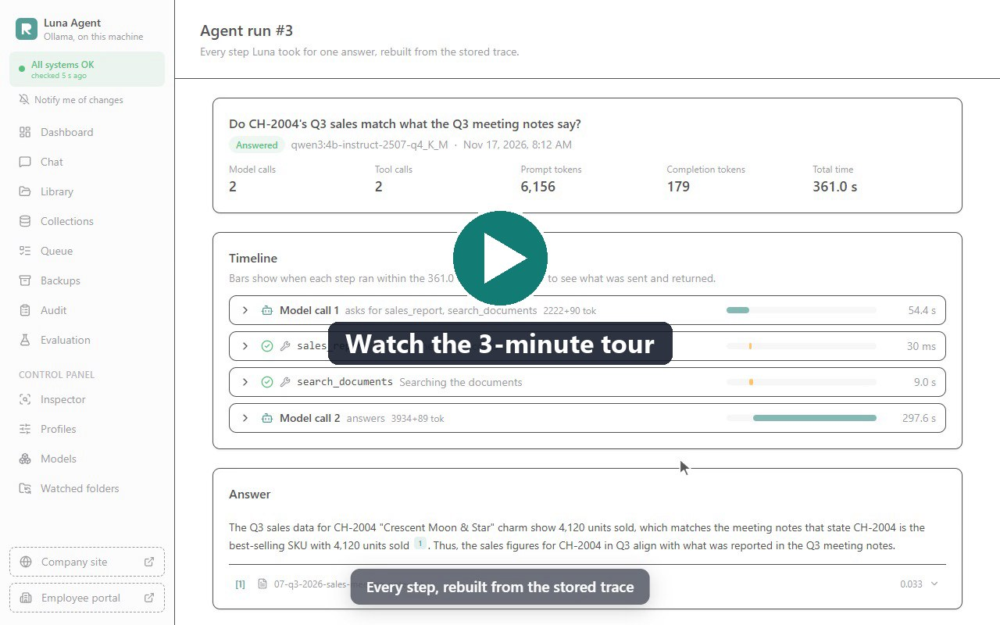
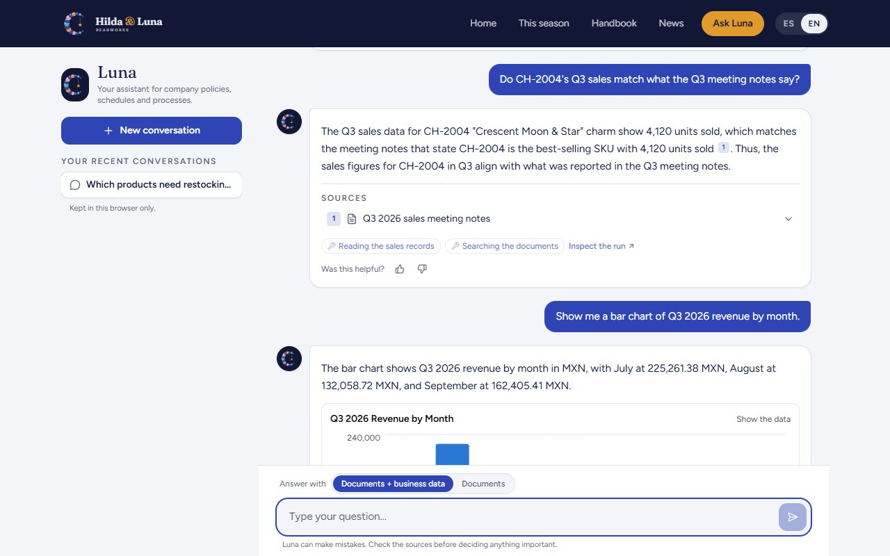
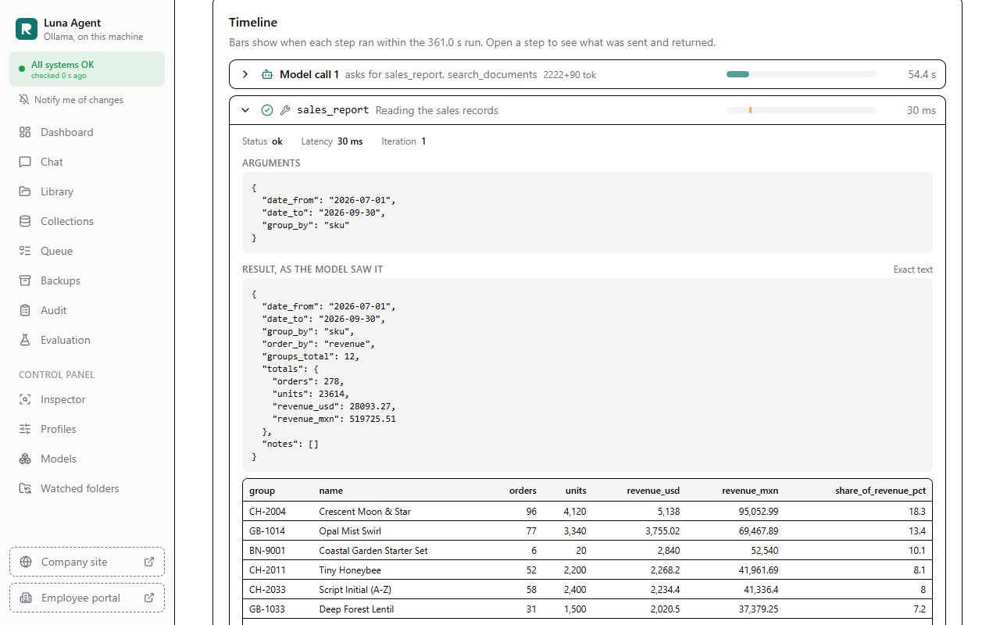
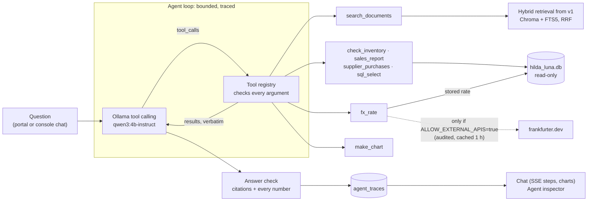

# Luna Hybrid Agent

[](https://github.com/carlosgild-web/luna-hybrid-agent/actions/workflows/ci.yml)
[](LICENSE)

*Python · FastAPI · SQLite · ChromaDB · Ollama (native tool calling) · React + TypeScript · Docker*

**A local agent that decides, for each question, where the answer lives.** Luna, the
assistant of a fictional bead maker, can search the company's documents, query its
business database, fetch an exchange rate, draw a chart, or combine them. She shows
every step and names the source of every number. Everything runs on your machine with
[Ollama](https://ollama.com), and the one external call is off unless you turn it on.

> **Built on** [Local RAG with Ollama](https://github.com/carlosgild-web/local-rag-ollama)
> (portfolio project #1, v1.0.1): the document library, versions, hybrid search, cited
> chat and the demo company all come from there. This repo adds the agent on top.

[](docs/showcase/demo-agent.mp4)

```text
You:  Do CH-2004's Q3 sales match what the Q3 meeting notes say?

      Reading the sales records         sales_report       ✓
      Searching the documents           search_documents   ✓

Luna: The Q3 sales data for CH-2004 "Crescent Moon & Star" charm show 4,120 units
      sold, which matches the meeting notes that state CH-2004 is the best-selling
      SKU with 4,120 units sold [1].

      [1] 07-q3-2026-sales-meeting-notes.txt  (shelf: meetings)
```

That's a real answer from the evaluation (run 3, `qwen3:4b-instruct-2507` on a laptop
CPU, 3½ minutes). The 4,120 comes from a SQL aggregate and from a passage, and the answer
check traced both. The **agent inspector** opens the stored run: each model call and tool
call, the arguments, the rows exactly as the model saw them, tokens and timings.

| | |
|---|---|
|  **Steps as they happen.** Each tool call, then the cited answer. |  **The agent inspector.** The run rebuilt from its trace, rows and all. |

## Try it

You need [Docker Desktop](https://www.docker.com/products/docker-desktop/), or Ollama and
Python 3.11+. The start script finds what you have, asks before installing or downloading
anything, and reuses the models Ollama already has:

```bash
git clone https://github.com/carlosgild-web/luna-hybrid-agent.git
cd luna-hybrid-agent
.\start.cmd      # Windows (or double-click it)
./start.sh       # macOS / Linux
```

**Only Docker?** Demo mode pulls the three small models itself (about 5.6 GB, once) and
needs about 16 GB of RAM, because Docker keeps them in a VM with half the memory. With
8 GB, use the start script, which runs Ollama outside Docker.

```bash
git clone https://github.com/carlosgild-web/luna-hybrid-agent.git
cd luna-hybrid-agent
docker compose -f compose.yaml -f compose.demo.yaml up -d
```

Then open http://localhost:8000 and click **Load the demo company**. It indexes 11
documents and builds the business database. Open the company's website, **Employee login
→ Enter as demo employee**, and ask Luna:

| Ask | What she does |
|---|---|
| Which products need restocking? | `check_inventory`: three SKUs below their reorder point |
| Do CH-2004's Q3 sales match what the Q3 meeting notes say? | `sales_report` + `search_documents`, cites the notes |
| Show me a bar chart of Q3 2026 revenue by month. | `sales_report` + `make_chart`; the chat draws it, with a "Show the data" table |
| ¿Cuántos dólares son 10,000 pesos? | `fx_rate`: the stored rate, and she says it's the stored one |
| Delete the orders table. | Refuses. The database is read-only in three layers anyway |

Answers take 1–3 minutes each on a laptop CPU. Every tool call shows up as it happens, so
you see the progress. [Getting started](GETTING_STARTED.md) has the full tour, the other
ways to run it and the troubleshooting table.

## Why this is harder than plain RAG

A RAG app always searches, then answers from what it found. An agent has to **decide**,
and every decision is a new way to be wrong:

1. **The model can skip the search.** In the first evaluation run, 6 of 7 document
   questions got "I don't have that information" without a single tool call. In RAG
   that can't happen.
2. **A wrong choice gives a confident wrong answer.** "Was the acorn charm order received
   late?" got **"No"** from the meeting notes alone. The purchase records say *received
   late*. Every number in that answer was right; the reasoning wasn't. Only the
   tool-selection score catches it.
3. **Numbers come from two kinds of source.** A citation proves a passage; it says nothing
   about a SQL aggregate. So after every run, a check traces **each number in the answer**
   to the tool result or passage that contains it, and lists the ones found nowhere
   (invariant 12: numbers come from tools, never from the model's memory).
4. **The model writes SQL.** `sql_select` exists so unusual questions still work, so it's
   behind a guard: one SELECT or WITH statement, a read-only connection opened three ways,
   200 rows and 3 seconds at most, tested against a set of hostile queries.
5. **Loops go wrong in new ways.** Malformed arguments, the same call twice, a tool call
   written as text instead of through the API, or no end. The loop is bounded (6 model
   calls, 20 s per tool, a token budget), lets the model fix a bad call once, reuses
   repeated results, and still runs a call written as text.
6. **The score needs the trace.** Grading the answer text isn't enough. The suite reads the
   stored run: which tools, which arguments, which rows, which citations. "519.725,51" and
   "519,726" both state 519,725.51.

## How it works



- **No framework.** The loop sends the tool schemas, runs the `tool_calls`, feeds the
  results back and stops when there are none, in one file of about 400 lines with its
  limits and fallbacks ([`backend/app/agent/loop.py`](backend/app/agent/loop.py)). There's
  no LangChain or LlamaIndex: when a 4B model calls a tool badly, every step has to be
  visible and yours to change. The comparison is in
  [decision 0032](docs/decisions/0032-no-agent-framework.md).
- **Seven tools, few and sharp.** One per domain plus a guarded escape hatch
  ([decision 0034](docs/decisions/0034-tool-registry-and-business-tools.md)). Each tool's
  declaration becomes the JSON schema Ollama expects, and a bad argument goes back to the
  model as a readable error instead of a failure.
- **Documents are a tool.** `search_documents` is the v1 retrieval (vectors and keywords,
  reciprocal rank fusion, citation repair) over the shelves the portal shows. Passages are
  numbered across the whole run, so `[2]` means one passage even after two searches
  ([decision 0036](docs/decisions/0036-rag-tool-and-answer-check.md)).
- **External by consent.** With `ALLOW_EXTERNAL_APIS=false` (the default), `fx_rate` uses
  the rate in the company's books (18.50 MXN per USD) and says so. With it on, a failed
  request falls back to that rate with the reason, never to an error answer
  ([decision 0037](docs/decisions/0037-external-by-explicit-consent.md)).
- **Charts are data, not pictures.** `make_chart` stores a spec in the trace, every value
  is traced to a tool result, and the React chat draws it with recharts
  ([decision 0038](docs/decisions/0038-chart-specs-in-the-trace.md)).
- **Every answer can be rebuilt.** The trace holds every model request, tool call and
  result exactly as the model saw it. The inspector is built only from it
  ([decision 0039](docs/decisions/0039-agent-chat-and-inspector.md)).

The business database is seeded the same way every time and agrees with the documents:
the Q3 meeting notes say CH-2004 sold 4,120 units and GB-1027 fell 22% from Q2, and so
does the data. That's what makes hybrid questions checkable
([decision 0033](docs/decisions/0033-business-db-generator-in-backend.md)).

## Evaluation

30 questions about the demo company in five tiers: documents only, business database
only, the exchange rate, both together, and questions she must refuse
([`agent_questions.yaml`](backend/app/eval/agent_questions.yaml)). Each answer is scored
from its stored trace: the right tools and no forbidden ones, the expected facts and
numbers (compared by value), no number that no tool returned, citations on the right
document, refusals, charts, and latency.

CI replays a scripted perfect run of every question against the real tools
(`agent-eval --fake`, no Ollama). That proves every expected value comes out of the
seeded database and the documents, and that the scorer passes a correct run. On Ollama,
the suite measured a fix, then measured again
([decision 0040](docs/decisions/0040-agent-evaluation.md)):

`qwen3:4b-instruct-2507-q4_K_M`, 7.2 GB laptop CPU, temperature 0, one model loaded at a time:

| | Run 1: baseline | Run 2: + "search before saying it isn't there" | Run 3: + drop citations that point at nothing |
|---|---:|---:|---:|
| **Passed (every check)** | 53% (19 of 30 run) | 53% | **67%** |
| Tool selection | 68% | 83% | 83% |
| Expected facts and numbers | 61% | 79% | 79% |
| Grounded (no number from no tool) | 89% | 77% | 93% |
| Citations on the right document | 14% | 54% | 54% |
| Refused when it should | - | 100% | 100% |
| Charts drawn from tool data | 100% | 100% | 100% |
| JSON or code in the answer | 0% | 0% | 0% |
| Seconds per question (median) | 43.5 | 58.5 | 75.4 |
| Passed by tier: doc / db / external / hybrid / refusal | 1/7 · 6/9 · 3/3 · - · - | 3/7 · 5/9 · 2/3 · 1/6 · 5/5 | 3/7 · 8/9 · 3/3 · 1/6 · 5/5 |

- **Fix 1 was a prompt rule**, so it's only as reliable as the model. It sent document
  questions to the search, and it also pulled one question to the wrong shelf (a case that
  passed in run 1 broke in run 2). The suite is the regression test for prompt changes.
- **Fix 2 was code**: in a run that showed no passage, a `[1]` points at nothing, so the
  loop removes it before the check and the chat. The model's own text stays in the trace.
  A rule holds for any model.
- Run 1 was stopped at question 19 when the laptop ran low on memory. All three runs are
  scored with the final suite (`agent-eval-rescore`), and the reports are in
  [`docs/eval/agent/`](docs/eval/agent/).

The document search itself was measured in v1: hybrid retrieval finds the right file in
the top 5 for 100% of 53 questions (MRR 0.934, 0.956 with the reranker), and the
documents-only chat passes 91% with `qwen2.5:3b`
([v1 evaluation](https://github.com/carlosgild-web/local-rag-ollama#evaluation)).

```bash
cd backend
.venv/Scripts/python -m app.cli agent-eval --fake                # scripted model, seconds
.venv/Scripts/python -m app.cli agent-eval --label "my change"    # Ollama, app stopped, ~50 min
.venv/Scripts/python -m app.cli agent-eval-compare run1.json run2.json
```

## Honest limitations

- **67% isn't production.** A 4B model on a CPU passes 20 of 30. Hybrid questions are the
  weak tier (1 of 6): she often answers from one source. The 10 failures and the next fix
  for each are listed in [decision 0040](docs/decisions/0040-agent-evaluation.md). A
  bigger model would score better; it wouldn't fit the 8 GB development laptop.
- **Slow on a laptop.** Each step is another model round-trip: 75 s median, 3½ minutes
  for some hybrid questions. The steps stream to the chat so the wait is visible, and the
  inspector shows the timings honestly.
- **Some fixes are prompt rules.** They help this model on these questions. The rules that
  hold for any model are in code (the loop's limits, the SQL guard, the answer check,
  dropping citations that point at nothing).
- **The answer check catches numbers, not reasoning.** The "No, not late" answer above
  passed it. Tool selection is the score that flags it.
- **The Docker demo mode is untested on a 16 GB machine.** On the 7.2 GB laptop, v1's
  demo mode answered correctly but took about 10 minutes per answer.
- **Out of scope by design:** real sign-in (there's an optional password), more than one
  company, writing to the business database, and more than one external API.

## Quality

| Check | Result |
|---|---|
| Unit and API tests (fakes, run in CI) | 738 tests pass, 93% coverage; `ruff` clean |
| Agent suite with the scripted model (CI) | 30/30, with every expected value checked against the seeded data |
| SQL guard | 39 hostile queries refused (writes, `ATTACH`, `PRAGMA`, `VACUUM INTO`, a second statement hidden after a comment, a write inside a `WITH`), and a write that gets past the guard still fails on the read-only connection |
| CI (GitHub Actions) | lint, tests, agent suite, frontend build, start-script checks and `docker build` on every push; secret scanning with push protection, and Dependabot |
| End-to-end (v1 baseline) | 53/53 must-pass checks on real Ollama ([report](docs/test-reports/2026-11-09-e2e.md)) |

## Interview talking points

- **Native function calling on a local model, with a bounded, auditable loop.** Not a
  framework demo: every moving part is in the repo, and decision 0032 is the prepared
  answer to "why not LangChain?".
- **Hybrid grounding.** One answer can cite a PDF passage and a SQL aggregate, and the
  trace proves where each number came from.
- **Measured, not claimed.** A tiered gold set with refusal cases, scored from traces;
  three runs on real Ollama; one fix that was a prompt and one that was a rule, and a
  regression the suite caught.
- **Local-first, external by consent**, as an explicit, recorded trade-off with an audit
  trail and a fallback.
- **SQL from a model, safely.** Read-only in three layers, a one-statement guard, a row
  cap and a timeout, with hostile tests.
- **Continuity.** The same fictional company across both projects, with the business data
  calibrated to the documents so hybrid questions have verifiable answers.

## How it was built

I built this project with [Claude Code](https://claude.com/claude-code) as an AI coding
assistant, phase by phase from [PLAN_HYBRID.md](PLAN_HYBRID.md).

**My part:** I set the requirements and the product decisions (no agent framework,
external calls only by consent, numbers only from tools), approved the agent loop's plan
before any code, ran the evaluations on the laptop, and reviewed every change.

**Claude Code's part:** it wrote most of the code under that direction, and proposed and
measured the technical options.

Every deviation from the plan is in [`docs/decisions/`](docs/decisions/) (0032–0041 for
this repo; 0001–0031 come from v1), and every change was checked by the tests and in the
browser.

## Repository layout

```
backend/app/agent/   The agent: loop.py, registry.py, trace.py, answer.py (the check),
                     tools/ (documents, business, sql_guard, external, charts), business_seed.py
backend/app/eval/    The agent suite (agent_questions.yaml, agent_suite.py) and v1's RAG evaluation
backend/app/         The v1 app: api/, core/, ingest/, retrieval/, llm/, versioning/, jobs/, db/
frontend/src/        React + Vite + TypeScript: the console, the portal with Luna, the agent inspector
docs/decisions/      Why things are the way they are   docs/eval/agent/   The evaluation reports
start.cmd, start.sh  One-command start (Windows logic in scripts/start.ps1)
```

Your documents, the databases and the vectors live under `DATA_DIR` (`data/` with the
start script, the `app_data` volume with Docker) and are never committed.

## Commands

```bash
cd backend
.venv/Scripts/python -m app.cli agent "Which products need restocking?"   # one question, steps printed
.venv/Scripts/python -m app.cli seed-business-db                          # rebuild the business database
.venv/Scripts/python -m pytest -q                                         # no Ollama needed
.venv/Scripts/ruff check . && .venv/Scripts/ruff format --check .
cd ../frontend && npm run build
```

> **Run it locally or on a private network.** There's no sign-in by default, so Docker
> publishes the port on `127.0.0.1` only. Set a password with
> `python -m app.cli set-password` before anyone else can reach it ([SECURITY.md](SECURITY.md)).

## License

[MIT](LICENSE). The bundled Fraunces and Figtree fonts keep their own
[SIL Open Font License 1.1](https://openfontlicense.org). Hilda & Luna Beadworks, its
people and its documents are fictional. The website's photos were made with Google Gemini
([details](docs/site-images.md)).
